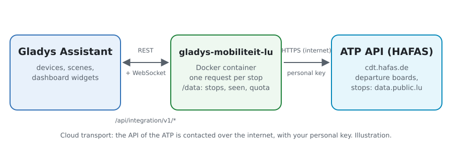
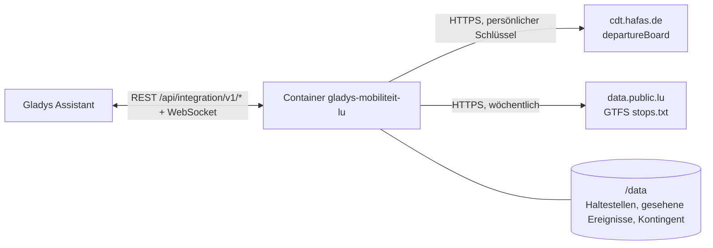
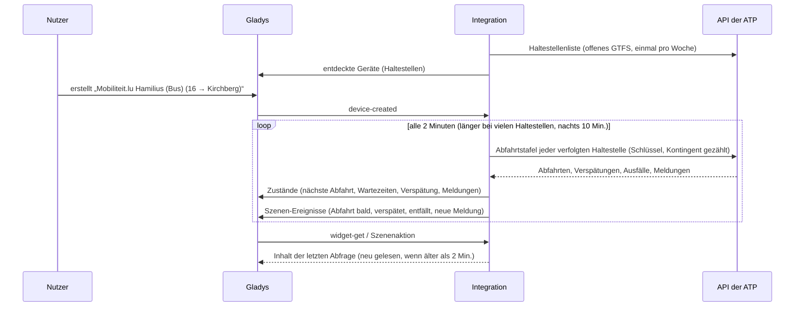
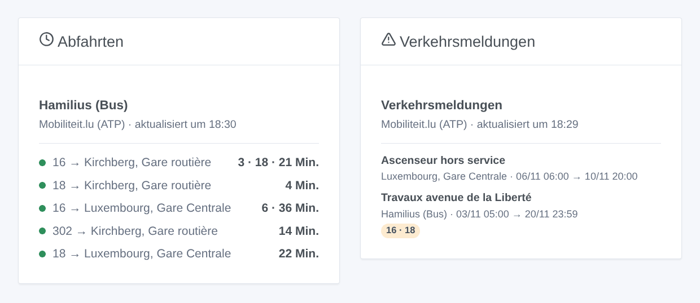

# Gladys Mobiliteit.lu

[English](README.md) · [Français](README.fr.md) · **Deutsch** · [Español](README.es.md)

[](LICENSE)
[](https://github.com/William-De71/gladys-mobiliteit-lu/releases)
[](https://github.com/William-De71/gladys-mobiliteit-lu/actions/workflows/release.yml)
[](https://gladysassistant.com)


Externe Integration für [Gladys Assistant](https://gladysassistant.com) für **Mobiliteit.lu**, die Busse, Trams und Züge Luxemburgs: die nächsten Abfahrten in Echtzeit an deinen Haltestellen, mit Verspätung, entfallenen Fahrten und Verkehrsmeldungen, mit Szenen und Dashboard-Widgets. Sie liest die offizielle Echtzeit-API der Administration des transports publics (ATP) mit deinem persönlichen Schlüssel.

Benutzerdokumentation: [English](docs/en.md) · [Français](docs/fr.md) · [Deutsch](docs/de.md) · [Español](docs/es.md).

> Community-Integration, weder mit der Administration des transports publics, mobiliteit.lu noch den Betreibern der Netze Luxemburgs verbunden oder von ihnen unterstützt.

> **Noch nicht mit einem echten Schlüssel getestet.** Der Code folgt dem veröffentlichten Schema der API (`rest-2.52.xsd`) und ihrer Dokumentation, und die Tests nutzen nach diesem Schema gebaute Abfahrtstafeln. Feedback von Nutzern mit Schlüssel ist willkommen.

## Funktionen

- **Ein Gerät pro verfolgter Haltestelle** (drei im Formular, bis zu 7 weitere mit der Schaltfläche **Haltestelle hinzufügen**), per Name oder Nummer eingegeben und nach **Linie** („16“, „T1“, „RE 11“ oder „tram“, „train“, „bus“) und **Richtung** gefiltert: nächste Abfahrt, Wartezeit der nächsten zwei Abfahrten, Verspätung der nächsten, Anzahl der Verkehrsmeldungen.
- **Alle Netze**: Busse von RGTR, AVL, TICE und CFL, Luxtram, Züge der CFL.
- **Echtzeit**: geschätzte Zeit und Verspätung, wenn das Fahrzeug verfolgt wird, sonst der Fahrplan (als solcher markiert), entfallene Fahrten.
- **4 Szenen-Auslöser**, **1 Szenenaktion** und **2 Dashboard-Widgets** (unten).
- **Das Kontingent des Schlüssels geschont**: Anfragen gezählt, Intervall bei vielen Haltestellen verlängert, Abfragen vor den Grenzen pausiert (etwa 500 pro Stunde, 5.000 pro Tag) und nach einer `API_QUOTA`-Antwort bis zur nächsten vollen Stunde.
- **Haltestellensuche ohne Schlüsselverbrauch**: Namen und Nummern stammen aus dem offenen GTFS der ATP, wöchentlich gelesen und in `/data` gespeichert.
- Schaltflächen der Konfiguration: Verbindung testen, Haltestelle suchen, Haltestellen hinzufügen / entfernen / auflisten, Diagnose (ohne Schlüssel).
- Vier Sprachen überall: Englisch, Französisch, Deutsch, Spanisch.

## Funktionsweise





Beim Start liest die Integration die Haltestellenliste des offenen GTFS der ATP (das neueste Zip des Datensatzes auf data.public.lu, nur seine `stops.txt`): eine GTFS-ID „000200405060“ ist die HAFAS-ID „200405060“. Sie löst auf, was du eingegeben hast („Hamilius“ ist „Hamilius (Bus)“, 200405020), liest dann die Abfahrtstafel jeder verfolgten Haltestelle (`departureBoard?id=…&format=json&duration=90`) mit eigenem Timer, eine Anfrage pro Haltestelle, und behält die Abfahrten der gewählten Linie und Richtung. Jede Abfrage wird mit der vorigen verglichen, um die Szenen-Auslöser auszulösen.



### Transport

Nur Cloud (`"transports": ["cloud"]`): Der Katalog zeigt das Cloud-Abzeichen. Die Integration kontaktiert `cdt.hafas.de` (mit deinem Schlüssel und den Nummern deiner Haltestellen) und `data.public.lu`. Es gibt keine lokale Alternative, daher keine Schaltfläche „lokale Verbindung bevorzugen“.

## Geräte und Funktionen

| Gerät                         | Funktion                           | Kategorie / Typ              | Werte                                                         |
| ----------------------------- | ---------------------------------- | ---------------------------- | ------------------------------------------------------------- |
| Mobiliteit.lu \<Haltestelle\> | Nächste Abfahrt                    | `text` / `text`              | „16 → Kirchberg, Gare routière · 3 Min. (+2 Min. Verspätung)“ |
| Mobiliteit.lu \<Haltestelle\> | Wartezeit, Wartezeit der folgenden | `duration` / `integer`       | 0 … 180 Min.                                                  |
| Mobiliteit.lu \<Haltestelle\> | Verspätung der nächsten Abfahrt    | `duration` / `integer`       | 0 … 120 Min.                                                  |
| Mobiliteit.lu \<Haltestelle\> | Verkehrsmeldungen                  | `counter-sensor` / `integer` | 0 … 20                                                        |

Nachts, ohne jede Abfahrt, behalten die Wartezeiten ihren letzten Wert (eine 0 würde einen Bus jetzt ankündigen); die Verspätung wird nur für eine in Echtzeit verfolgte Abfahrt veröffentlicht.

## Szenen-Auslöser, Aktionen und Widgets



**Szenen-Auslöser** (einmal pro Übergang; die erste Abfrage ist eine Referenz und löst nichts aus):

- **Abfahrt bald**: Eine Abfahrt an einer verfolgten Haltestelle fährt in 2, 3, 5, 10, 15 oder 20 Minuten, nach der Echtzeit-Schätzung. Filter: Haltestelle, Minuten.
- **Abfahrt verspätet**: Die Verspätung einer Abfahrt der nächsten Stunde erreicht 3, 5, 10 oder 15 Minuten. Filter: Haltestelle, Minuten.
- **Abfahrt entfällt**: Eine Fahrt der nächsten Stunde an einer verfolgten Haltestelle entfällt. Filter: Haltestelle.
- **Neue Verkehrsmeldung**: eine neue Meldung zu den Abfahrten einer verfolgten Haltestelle. Filter: Haltestelle.

**Szenenaktion**: **nächste Abfahrten** einer Haltestelle (Linie, Ziel, Wartezeit, Zeit, Echtzeit oder nicht, Verspätung, die folgende, ein Satz).

**Widgets**: **Abfahrten** (eine verfolgte Haltestelle, mehrere in einer Liste oder eine beliebige in den Einstellungen eingegebene) und **Verkehrsmeldungen** (die verfolgten Haltestellen oder die gewählten).

Beispiele:

- Wenn **die 16 Richtung Kirchberg in 5 Minuten an Hamilius abfährt** → die Flurlampe grün schalten.
- Wenn **dein Zug 10 Minuten Verspätung hat** oder **entfällt** → `{{triggerEvent.data.summary}}` an dein Handy senden.
- Jeden Werktag um 7:30 → **die nächsten Abfahrten** deiner Haltestelle lesen und die `summary` vom Küchenlautsprecher sprechen lassen.

## Voraussetzungen

- Gladys Assistant **5.3.0** oder neuer (Widgets und Szenen-Auslöser externer Integrationen, Katalog-Schlüsselwörter und -Länder von Gladys 5.3). Ältere Instanzen können die Integration nicht installieren.
- Ein persönlicher, kostenloser Schlüssel der API: Frag ihn per E-Mail bei `opendata-api@atp.etat.lu` an.

## Installation

- **Aus dem Store** von Gladys (Integrationen → Externe Integrationen), mit einem Klick, sobald indexiert.
- **Über die URL des Repositorys**: `https://github.com/William-De71/gladys-mobiliteit-lu`.
- **Entwicklermodus**: das Image lokal bauen (`docker build -t gladys-mobiliteit-lu .`) und in Gladys installieren.

## Konfiguration

| Feld                     | Beschreibung                                                                               |
| ------------------------ | ------------------------------------------------------------------------------------------ |
| Zugangsschlüssel         | Der Schlüssel der ATP (Geheimnis, nie protokolliert).                                      |
| Haltestelle (1 bis 3)    | Ein Name („Hamilius“, „Luxembourg, Gare Centrale“) oder eine Nummer („200405060“).         |
| Linie                    | „16“, „T1“, „RE 11“ oder „tram“, „train“, „bus“. Leer: alle Linien der Haltestelle.        |
| Richtung                 | Wörter des Ziels: „Kirchberg“, „Findel \| Kirchberg“. Leer: beide.                         |
| Abfrage der Haltestellen | 1 Min., 2 Min. (Standard), 5 Min. oder 10 Min.; bei vielen Haltestellen von selbst länger. |
| Sprache der Texte        | Gerätenamen, Szenen-Zusammenfassungen und -Ausgaben, Sprache der Verkehrsmeldungen.        |

Schaltflächen: **Verbindung testen**, **Haltestelle suchen** (in der offenen Haltestellenliste, ohne Schlüsselverbrauch), **Haltestelle hinzufügen**, **Haltestelle entfernen**, **Haltestellen auflisten** (die Haltestellen über die drei des Formulars hinaus, in der Gladys-Konfiguration gespeichert) und **Diagnose** (schreibt Haltestellen, letzte Abfahrten, Fehler, Kontingent und Anfragen in den Tab Protokolle, nie den Schlüssel).

## Verwendung

1. Bei der ATP einen Schlüssel anfragen, einfügen, eine bis drei Haltestellen eingeben — mehr mit **Haltestelle hinzufügen** — (mit Linie und Richtung, wenn gewünscht), dann speichern.
2. Im Tab **Entdecken** die Geräte „Mobiliteit.lu …“ erstellen.
3. Die Widgets **Abfahrten** und **Verkehrsmeldungen** zu einem Dashboard hinzufügen und Szenen mit den Auslösern oben bauen.

## Entwicklung

```bash
npm install
npm test                       # node --test, berührt nie das Netzwerk
npm run lint && npm run format:check
npx github:GladysAssistant/integration-store . --skip-image-check
scripts/build-cover.sh         # cover.jpg aus docs/assets/cover.svg
docs/illustrations/render.sh   # docs/assets/widgets.<lang>.png
node .github/scripts/release.mjs next
```

Lokal liest das SDK `GLADYS_HOST_API_URL`, `GLADYS_INTEGRATION_TOKEN` und `GLADYS_INTEGRATION_SELECTOR`; `MOBILITEIT_API_URL` und `MOBILITEIT_GTFS_DATASET_URL` lenken die Integration auf andere Wurzeln (ein Mock); `DEBUG=gladys-integration-sdk` zeigt die SDK-Protokolle und prüft jeden Widget-Inhalt. Die Tests nutzen nach dem Schema der API gebaute Abfahrtstafeln und einen Auszug der echten `stops.txt` (`test/fixtures/`, CC BY 4.0). Die Regeln des Projekts stehen in [CLAUDE.md](CLAUDE.md).

## Release-Prozess


Jeder Merge auf `main` startet die CI und berechnet dann die Version aus den [Conventional Commits](https://www.conventionalcommits.org/de/) seit dem letzten Tag: `feat` → Minor, `fix` / `perf` → Patch, `!` oder `BREAKING CHANGE` → Major (ein Minor unter 1.0.0); `docs`, `chore`, `ci`, `test`, `style`, `refactor`, `build` allein veröffentlichen nichts. Der Changelog-Abschnitt wird erzeugt, der Tag gepusht, das Multi-Architektur-Image gebaut, dann erhält `main` den Release-Commit, das GitHub-Release wird erstellt und ein letzter Job prüft das öffentliche Image, den Store-Validator und das Topic.

- Der Titel des Pull Requests wird zum Squash-Commit, dann zur Changelog-Zeile: auf Englisch, für den Nutzer schreiben (`pr-title.yml` prüft ihn). `CHANGELOG.md` nie von Hand bearbeiten.
- 1.0.0 ist eine Entscheidung: Actions → Release → Run workflow mit `release-as: 1.0.0`. `dry-run` zeigt Version und Notizen, ohne zu veröffentlichen.
- **Geschützter Branch**: Das Release pusht seinen Commit mit `GITHUB_TOKEN` auf `main`. Bei einem Ruleset auf `main`, das strenger als „kein Löschen, kein Force-Push“ ist, GitHub Actions zur Bypass-Liste hinzufügen (oder über eine GitHub App pushen), sonst schlägt der Veröffentlichungsjob mit Anweisungen fehl.
- Nach dem ersten Release das Paket `ghcr.io` öffentlich machen (Package settings → Change visibility), sonst kann Gladys es nicht laden.

## Fehlerbehebung

Siehe [docs/de.md](docs/de.md#fehlerbehebung). Probleme mit den Versionen von Gladys und der Integration, der betroffenen Haltestelle und den Zeilen der Schaltfläche **Diagnose** melden.

## Mitwirken

Issues und Pull Requests sind willkommen. Vor einem Pull Request `npm run format:check && npm run lint && npm test` ausführen und alle External IDs und gespeicherten Schlüssel unverändert lassen (siehe [CLAUDE.md](CLAUDE.md)).

## Sicherheit

Siehe [SECURITY.md](SECURITY.md): Schwachstellen vertraulich melden. Der Zugangsschlüssel ist ein Geheimnis der Konfiguration: Er wird nur an die API der ATP gesendet und nie in die Protokolle, die Diagnose oder Fehlermeldungen geschrieben. Der Container läuft schreibgeschützt, als Nicht-Root-Benutzer.

## Kommende Screenshots

Die Bilder oben sind Illustrationen, keine Screenshots. Echte Screenshots kommen nach `docs/assets/screenshots/` (PNG, 1280 × 800): `configuration.png`, `discovery.png`, `device.png`, `scene.png`.

## Lizenz

[Apache License 2.0](LICENSE) — siehe auch [NOTICE](NOTICE). Die Abfahrten und Haltestellen sind Daten der Administration des transports publics (mobiliteit.lu) unter [CC BY 4.0](https://creativecommons.org/licenses/by/4.0/deed.de): Die Widgets zeigen die Quelle und die Zeit jeder Abfrage. Dank an die Dokumentation und das SDK von Gladys und an die ATP für die Öffnung ihrer Echtzeit-API.
