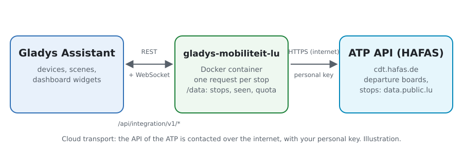
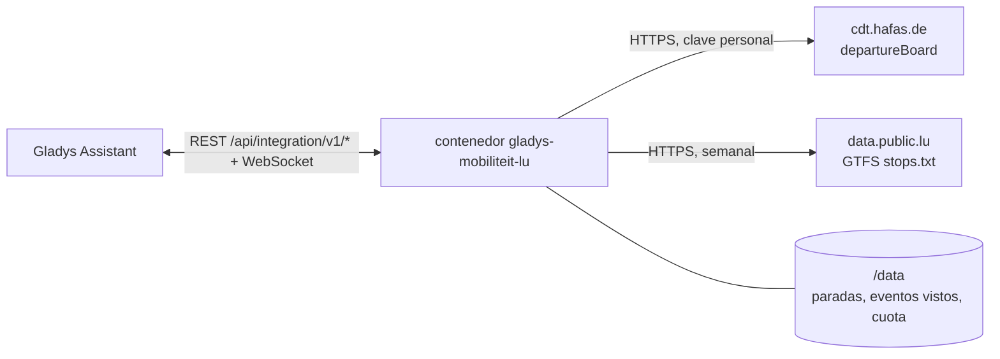
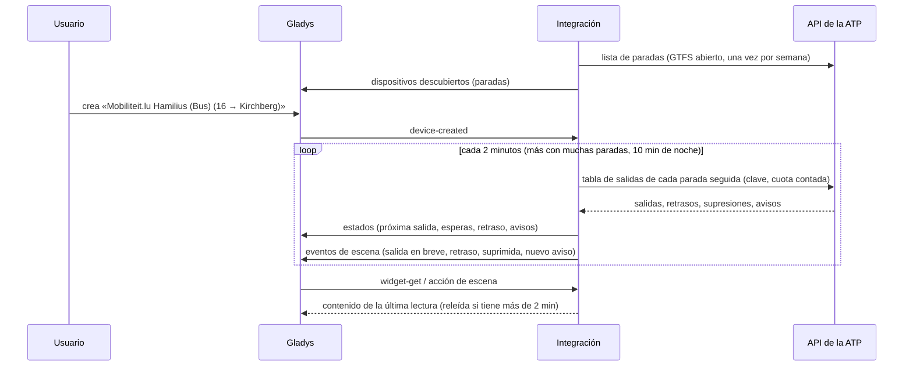
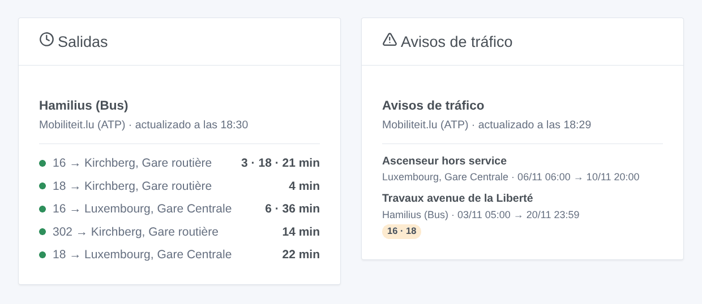

# Gladys Mobiliteit.lu

[English](README.md) · [Français](README.fr.md) · [Deutsch](README.de.md) · **Español**

[](LICENSE)
[](https://github.com/William-De71/gladys-mobiliteit-lu/releases)
[](https://github.com/William-De71/gladys-mobiliteit-lu/actions/workflows/release.yml)
[](https://gladysassistant.com)


Integración externa de [Gladys Assistant](https://gladysassistant.com) para **Mobiliteit.lu**, los autobuses, tranvías y trenes de Luxemburgo: las próximas salidas en tiempo real en tus paradas, con su retraso, los trayectos suprimidos y los avisos de tráfico, con escenas y widgets. Lee la API oficial en tiempo real de la Administration des transports publics (ATP), con tu clave personal.

Documentación de usuario: [English](docs/en.md) · [Français](docs/fr.md) · [Deutsch](docs/de.md) · [Español](docs/es.md).

> Integración comunitaria, no afiliada ni respaldada por la Administration des transports publics, mobiliteit.lu ni los operadores de las redes de Luxemburgo.

> **Aún no probada con una clave real.** El código sigue el esquema publicado de la API (`rest-2.52.xsd`) y su documentación, y las pruebas usan tablas de salidas construidas a partir de ese esquema. Se agradecen los comentarios de un usuario con clave.

## Funciones

- **Un dispositivo por parada seguida** (tres en el formulario, hasta 7 más con el botón **Añadir una parada**), escrita por nombre o número y filtrada por **línea** («16», «T1», «RE 11», o «tram», «train», «bus») y **dirección**: próxima salida, espera de las dos próximas salidas, retraso de la próxima, número de avisos de tráfico.
- **Todas las redes**: autobuses de RGTR, AVL, TICE y CFL, el Luxtram, trenes de CFL.
- **Tiempo real**: la hora estimada y el retraso cuando se sigue el vehículo, si no el horario teórico (indicado como tal), los trayectos suprimidos.
- **4 disparadores de escena**, **1 acción de escena** y **2 widgets** (abajo).
- **La cuota de la clave cuidada**: peticiones contadas, intervalo alargado con muchas paradas, lecturas en pausa antes de los límites (unas 500 por hora, 5.000 al día) y hasta la siguiente hora en punto tras una respuesta `API_QUOTA`.
- **Búsqueda de paradas sin gastar la clave**: los nombres y números vienen del GTFS abierto de la ATP, leído cada semana y guardado en `/data`.
- Botones de configuración: probar la conexión, buscar una parada, añadir / quitar / listar paradas, diagnóstico (sin la clave).
- Cuatro idiomas en todas partes: inglés, francés, alemán, español.

## Funcionamiento





Al arrancar, la integración lee la lista de paradas del GTFS abierto de la ATP (el zip más reciente del conjunto de datos en data.public.lu, solo su `stops.txt`): un identificador GTFS «000200405060» es el identificador HAFAS «200405060». Resuelve lo que escribiste («Hamilius» es «Hamilius (Bus)», 200405020) y luego lee la tabla de salidas de cada parada seguida (`departureBoard?id=…&format=json&duration=90`) con su propio temporizador, una petición por parada, y conserva las salidas de la línea y dirección elegidas. Cada lectura se compara con la anterior para disparar las escenas.



### Transporte

Solo nube (`"transports": ["cloud"]`): el catálogo muestra la insignia de nube. La integración contacta con `cdt.hafas.de` (con tu clave y los números de tus paradas) y `data.public.lu`. No hay alternativa local, así que no hay botón «preferir la conexión local».

## Dispositivos y funciones

| Dispositivo              | Función                      | Categoría / tipo             | Valores                                                     |
| ------------------------ | ---------------------------- | ---------------------------- | ----------------------------------------------------------- |
| Mobiliteit.lu \<parada\> | Próximo paso                 | `text` / `text`              | «16 → Kirchberg, Gare routière · 3 min (+2 min de retraso)» |
| Mobiliteit.lu \<parada\> | Espera, espera del siguiente | `duration` / `integer`       | 0 … 180 min                                                 |
| Mobiliteit.lu \<parada\> | Retraso del próximo paso     | `duration` / `integer`       | 0 … 120 min                                                 |
| Mobiliteit.lu \<parada\> | Avisos de tráfico            | `counter-sensor` / `integer` | 0 … 20                                                      |

De noche, sin ninguna salida, las esperas conservan su último valor (un 0 anunciaría un autobús ahora); el retraso solo se publica para una salida seguida en tiempo real.

## Disparadores, acciones de escena y widgets



**Disparadores de escena** (una vez por transición; la primera lectura es una referencia y no dispara nada):

- **Salida en breve**: una salida en una parada seguida sale dentro de 2, 3, 5, 10, 15 o 20 minutos, según su estimación en tiempo real. Filtros: parada, minutos.
- **Salida con retraso**: el retraso de una salida de la próxima hora alcanza 3, 5, 10 o 15 minutos. Filtros: parada, minutos.
- **Salida suprimida**: un trayecto de la próxima hora en una parada seguida queda suprimido. Filtro: parada.
- **Nuevo aviso de tráfico**: un nuevo mensaje sobre las salidas de una parada seguida. Filtro: parada.

**Acción de escena**: **próximas salidas** de una parada (línea, destino, espera, hora, tiempo real o no, retraso, la siguiente, una frase).

**Widgets**: **Salidas** (una parada seguida, varias en una lista, o cualquier parada escrita en los ajustes) y **Avisos de tráfico** (las paradas seguidas, o las elegidas).

Ejemplos:

- Cuando **el 16 hacia Kirchberg sale de Hamilius dentro de 5 minutos** → encender la lámpara de la entrada en verde.
- Cuando **tu tren lleva 10 minutos de retraso** o **se suprime** → enviar `{{triggerEvent.data.summary}}` a tu teléfono.
- Cada día laborable a las 7:30 → **leer las próximas salidas** de tu parada y que el altavoz de la cocina diga el `summary`.

## Requisitos

- Gladys Assistant **5.3.0** o posterior (widgets y disparadores de escena de las integraciones externas, palabras clave y países del catálogo de Gladys 5.3). Las instancias más antiguas no pueden instalar la integración.
- Una clave personal de la API, gratuita: pídela por correo a `opendata-api@atp.etat.lu`.

## Instalación

- **Desde la tienda** de Gladys (Integraciones → Integraciones externas), con un clic, una vez indexada.
- **Desde la URL del repositorio**: `https://github.com/William-De71/gladys-mobiliteit-lu`.
- **Modo desarrollador**: construye la imagen en local (`docker build -t gladys-mobiliteit-lu .`) e instálala desde Gladys.

## Configuración

| Campo                  | Descripción                                                                           |
| ---------------------- | ------------------------------------------------------------------------------------- |
| Clave de acceso        | La clave de la ATP (secreto, nunca registrada).                                       |
| Parada (1 a 3)         | Un nombre («Hamilius», «Luxembourg, Gare Centrale») o un número («200405060»).        |
| Línea                  | «16», «T1», «RE 11», o «tram», «train», «bus». Vacío: todas las líneas.               |
| Dirección              | Palabras del destino: «Kirchberg», «Findel \| Kirchberg». Vacío: ambos sentidos.      |
| Lectura de las paradas | 1 min, 2 min (por defecto), 5 min o 10 min; más largo por sí solo con muchas paradas. |
| Idioma de los textos   | Nombres de dispositivos, resúmenes y salidas de escenas, idioma de los avisos.        |

Botones: **Probar la conexión**, **Buscar una parada** (en la lista abierta de paradas, sin gastar la clave), **Añadir una parada**, **Quitar una parada**, **Listar las paradas** (las paradas más allá de las tres del formulario, guardadas en la configuración de Gladys) y **Diagnóstico** (escribe las paradas, últimas salidas, errores, cuota y peticiones en la pestaña Registros, nunca la clave).

## Uso

1. Pide una clave a la ATP, pégala, escribe de una a tres paradas — más con **Añadir una parada** — (con su línea y dirección si quieres) y guarda.
2. En la pestaña **Descubrir**, crea los dispositivos «Mobiliteit.lu …».
3. Añade los widgets **Salidas** y **Avisos de tráfico** a un panel, y crea escenas con los disparadores de arriba.

## Desarrollo

```bash
npm install
npm test                       # node --test, nunca toca la red
npm run lint && npm run format:check
npx github:GladysAssistant/integration-store . --skip-image-check
scripts/build-cover.sh         # cover.jpg desde docs/assets/cover.svg
docs/illustrations/render.sh   # docs/assets/widgets.<lang>.png
node .github/scripts/release.mjs next
```

En local, el SDK lee `GLADYS_HOST_API_URL`, `GLADYS_INTEGRATION_TOKEN` y `GLADYS_INTEGRATION_SELECTOR`; `MOBILITEIT_API_URL` y `MOBILITEIT_GTFS_DATASET_URL` dirigen la integración a otras raíces (un simulacro); `DEBUG=gladys-integration-sdk` muestra los registros del SDK y comprueba cada contenido de widget. Las pruebas usan tablas de salidas construidas a partir del esquema de la API y un extracto del `stops.txt` real (`test/fixtures/`, CC BY 4.0). Las reglas del proyecto están en [CLAUDE.md](CLAUDE.md).

## Proceso de release


Cada fusión en `main` lanza la CI y calcula la versión a partir de los [Conventional Commits](https://www.conventionalcommits.org/es/) desde la última etiqueta: `feat` → menor, `fix` / `perf` → parche, `!` o `BREAKING CHANGE` → mayor (una menor por debajo de 1.0.0); `docs`, `chore`, `ci`, `test`, `style`, `refactor`, `build` solos no publican nada. Se genera la sección del changelog, se empuja la etiqueta, se construye la imagen multiarquitectura, luego `main` recibe el commit de release, se crea la GitHub Release y un último job comprueba la imagen pública, el validador de la tienda y el topic.

- El título de la pull request se convierte en el commit squash y luego en la línea del changelog: escríbelo en inglés, para el usuario (`pr-title.yml` lo comprueba). Nunca edites `CHANGELOG.md` a mano.
- La 1.0.0 es una decisión: Actions → Release → Run workflow con `release-as: 1.0.0`. `dry-run` muestra la versión y las notas sin publicar.
- **Rama protegida**: la release empuja su commit a `main` con `GITHUB_TOKEN`. Con un ruleset en `main` más estricto que «sin borrado, sin force-push», añade GitHub Actions a su lista de omisión (o empuja mediante una GitHub App); si no, el job de publicación falla con instrucciones.
- Tras la primera release, haz público el paquete `ghcr.io` (Package settings → Change visibility); si no, Gladys no puede descargarlo.

## Solución de problemas

Consulta [docs/es.md](docs/es.md#solución-de-problemas). Informa de los problemas con las versiones de Gladys y de la integración, la parada afectada y las líneas del botón **Diagnóstico**.

## Contribuir

Issues y pull requests bienvenidos. Ejecuta `npm run format:check && npm run lint && npm test` antes de abrir una pull request y mantén sin cambios todos los external ids y claves guardadas (consulta [CLAUDE.md](CLAUDE.md)).

## Seguridad

Consulta [SECURITY.md](SECURITY.md): informa de las vulnerabilidades en privado. La clave de acceso es un secreto de la configuración: solo se envía a la API de la ATP y nunca se escribe en los registros, el diagnóstico ni los mensajes de error. El contenedor funciona en solo lectura, con un usuario no root.

## Capturas pendientes

Las imágenes de arriba son ilustraciones, no capturas de pantalla. Las capturas reales irán en `docs/assets/screenshots/` (PNG, 1280 × 800): `configuration.png`, `discovery.png`, `device.png`, `scene.png`.

## Licencia

[Licencia Apache 2.0](LICENSE) — consulta también [NOTICE](NOTICE). Las salidas y las paradas son datos de la Administration des transports publics (mobiliteit.lu) con licencia [CC BY 4.0](https://creativecommons.org/licenses/by/4.0/deed.es): los widgets muestran la fuente y la hora de cada lectura. Gracias a la documentación y al SDK de Gladys, y a la ATP por abrir su API en tiempo real.
