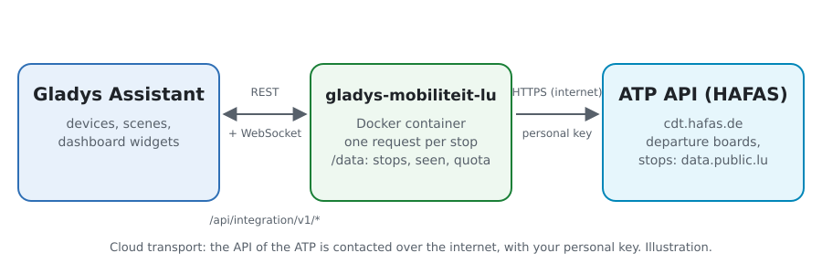
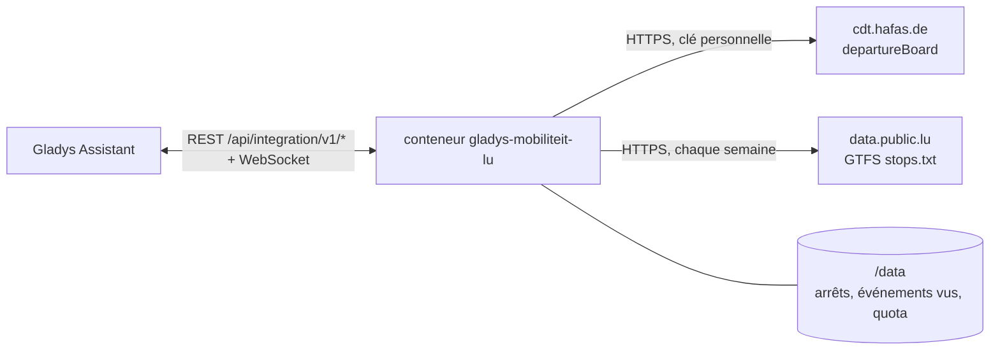
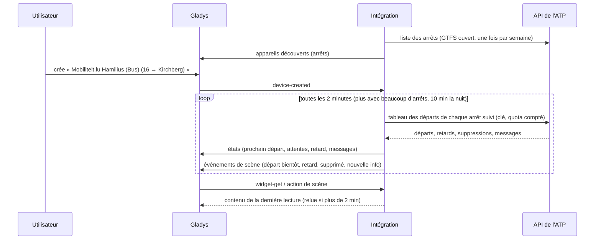
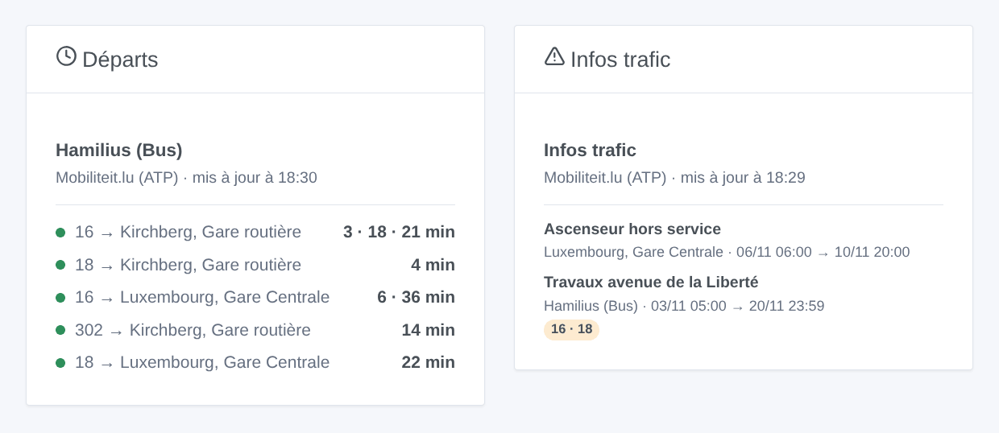

# Gladys Mobiliteit.lu

[English](README.md) · **Français** · [Deutsch](README.de.md) · [Español](README.es.md)

[](LICENSE)
[](https://github.com/William-De71/gladys-mobiliteit-lu/releases)
[](https://github.com/William-De71/gladys-mobiliteit-lu/actions/workflows/release.yml)
[](https://gladysassistant.com)


Intégration externe [Gladys Assistant](https://gladysassistant.com) pour **Mobiliteit.lu**, les bus, trams et trains du Luxembourg : les prochains départs en temps réel à vos arrêts, avec leur retard, les trajets supprimés et les infos trafic, avec scènes et widgets. Elle lit l’API temps réel officielle de l’Administration des transports publics (ATP), avec votre clé personnelle.

Documentation utilisateur : [English](docs/en.md) · [Français](docs/fr.md) · [Deutsch](docs/de.md) · [Español](docs/es.md).

> Intégration communautaire, ni affiliée ni approuvée par l’Administration des transports publics, mobiliteit.lu ou les exploitants des réseaux du Luxembourg.

> **Pas encore testée avec une vraie clé.** Le code suit le schéma publié de l’API (`rest-2.52.xsd`) et sa documentation, et les tests utilisent des tableaux de départs construits d’après ce schéma. Les retours d’un utilisateur muni d’une clé sont bienvenus.

## Fonctionnalités

- **Un appareil par arrêt suivi** (trois dans le formulaire, jusqu’à 7 de plus avec le bouton **Ajouter un arrêt**), saisi par son nom ou son numéro et filtré par **ligne** (« 16 », « T1 », « RE 11 », ou « tram », « train », « bus ») et **direction** : prochain départ, attente des deux prochains départs, retard du prochain, nombre d’infos trafic.
- **Tous les réseaux** : bus RGTR, AVL, TICE et CFL, Luxtram, trains CFL.
- **Temps réel** : l’heure estimée et le retard quand le véhicule est suivi, sinon l’horaire théorique (signalé comme tel), les trajets supprimés.
- **4 déclencheurs de scène**, **1 action de scène** et **2 widgets** (ci-dessous).
- **Le quota de la clé ménagé** : requêtes comptées, intervalle allongé avec beaucoup d’arrêts, lectures en pause avant les limites (environ 500 par heure, 5 000 par jour) et jusqu’à l’heure pleine suivante après une réponse `API_QUOTA`.
- **Recherche d’arrêt sans consommer la clé** : noms et numéros viennent du GTFS ouvert de l’ATP, relu chaque semaine et gardé dans `/data`.
- Boutons de configuration : tester la connexion, chercher un arrêt, ajouter / retirer / lister les arrêts, diagnostic (sans la clé).
- Quatre langues partout : anglais, français, allemand, espagnol.

## Fonctionnement





Au démarrage, l’intégration lit la liste des arrêts du GTFS ouvert de l’ATP (le zip le plus récent du jeu de données sur data.public.lu, seulement son `stops.txt`) : un identifiant GTFS « 000200405060 » est l’identifiant HAFAS « 200405060 ». Elle retrouve ce que vous avez saisi (« Hamilius » est « Hamilius (Bus) », 200405020), puis lit le tableau des départs de chaque arrêt suivi (`departureBoard?id=…&format=json&duration=90`) sur son propre minuteur, une requête par arrêt, et garde les départs de la ligne et de la direction choisies. Chaque lecture est comparée à la précédente pour déclencher les scènes.



### Transport

Cloud uniquement (`"transports": ["cloud"]`) : le catalogue affiche le badge cloud. L’intégration contacte `cdt.hafas.de` (avec votre clé et les numéros de vos arrêts) et `data.public.lu`. Il n’existe pas d’alternative locale, donc pas de bouton « préférer la connexion locale ».

## Appareils et fonctionnalités

| Appareil                | Fonctionnalité              | Catégorie / type             | Valeurs                                                      |
| ----------------------- | --------------------------- | ---------------------------- | ------------------------------------------------------------ |
| Mobiliteit.lu \<arrêt\> | Prochain passage            | `text` / `text`              | « 16 → Kirchberg, Gare routière · 3 min (+2 min de retard) » |
| Mobiliteit.lu \<arrêt\> | Attente, attente du suivant | `duration` / `integer`       | 0 … 180 min                                                  |
| Mobiliteit.lu \<arrêt\> | Retard du prochain passage  | `duration` / `integer`       | 0 … 120 min                                                  |
| Mobiliteit.lu \<arrêt\> | Infos trafic                | `counter-sensor` / `integer` | 0 … 20                                                       |

La nuit, sans aucun départ, les attentes gardent leur dernière valeur (un 0 annoncerait un bus maintenant) ; le retard n’est publié que pour un départ suivi en temps réel.

## Déclencheurs, actions de scène et widgets



**Déclencheurs de scène** (une fois par transition ; la première lecture sert de référence et ne déclenche rien) :

- **Départ bientôt** : un départ à un arrêt suivi part dans 2, 3, 5, 10, 15 ou 20 minutes, d’après son heure estimée. Filtres : arrêt, minutes.
- **Départ en retard** : le retard d’un départ de l’heure à venir atteint 3, 5, 10 ou 15 minutes. Filtres : arrêt, minutes.
- **Départ supprimé** : un trajet de l’heure à venir à un arrêt suivi est supprimé. Filtre : arrêt.
- **Nouvelle info trafic** : un nouveau message sur les départs d’un arrêt suivi. Filtre : arrêt.

**Action de scène** : **prochains départs** d’un arrêt (ligne, destination, attente, heure, temps réel ou non, retard, le suivant, une phrase).

**Widgets** : **Départs** (un arrêt suivi, plusieurs dans une liste, ou n’importe quel arrêt saisi dans les réglages) et **Infos trafic** (les arrêts suivis, ou ceux choisis).

Exemples :

- Quand **le 16 vers Kirchberg part de Hamilius dans 5 minutes** → allumer la lampe de l’entrée en vert.
- Quand **votre train a 10 minutes de retard** ou **est supprimé** → envoyer `{{triggerEvent.data.summary}}` sur votre téléphone.
- Chaque jour de semaine à 7 h 30 → **lire les prochains départs** de votre arrêt et faire dire le `summary` par l’enceinte de la cuisine.

## Prérequis

- Gladys Assistant **5.3.0** ou plus récent (widgets et déclencheurs de scène des intégrations externes, mots-clés et pays du catalogue de Gladys 5.3). Les instances plus anciennes ne peuvent pas installer l’intégration.
- Une clé personnelle de l’API, gratuite : demandez-la par e-mail à `opendata-api@atp.etat.lu`.

## Installation

- **Depuis le store** de Gladys (Intégrations → Intégrations externes), en un clic, une fois indexée.
- **Depuis l’URL du dépôt** : `https://github.com/William-De71/gladys-mobiliteit-lu`.
- **Mode développeur** : construisez l’image en local (`docker build -t gladys-mobiliteit-lu .`) et installez-la depuis Gladys.

## Configuration

| Champ              | Description                                                                                |
| ------------------ | ------------------------------------------------------------------------------------------ |
| Clé d’accès        | La clé de l’ATP (secret, jamais journalisée).                                              |
| Arrêt (1 à 3)      | Un nom (« Hamilius », « Luxembourg, Gare Centrale ») ou un numéro (« 200405060 »).         |
| Ligne              | « 16 », « T1 », « RE 11 », ou « tram », « train », « bus ». Vide : toutes les lignes.      |
| Direction          | Mots de la destination : « Kirchberg », « Findel \| Kirchberg ». Vide : les deux sens.     |
| Lecture des arrêts | 1 min, 2 min (par défaut), 5 min ou 10 min ; plus long de lui-même avec beaucoup d’arrêts. |
| Langue des textes  | Noms des appareils, résumés et sorties des scènes, langue des infos trafic.                |

Boutons : **Tester la connexion**, **Chercher un arrêt** (dans la liste ouverte des arrêts, sans consommer la clé), **Ajouter un arrêt**, **Retirer un arrêt**, **Lister les arrêts** (les arrêts au-delà des trois du formulaire, gardés dans la configuration de Gladys) et **Diagnostic** (écrit les arrêts, derniers départs, erreurs, quota et requêtes dans l’onglet Journaux, jamais la clé).

## Utilisation

1. Demandez une clé à l’ATP, collez-la, saisissez un à trois arrêts — plus avec **Ajouter un arrêt** — (avec leur ligne et leur direction si vous voulez), puis enregistrez.
2. Dans l’onglet **Découvrir**, créez les appareils « Mobiliteit.lu … ».
3. Ajoutez les widgets **Départs** et **Infos trafic** à un tableau de bord, et créez des scènes avec les déclencheurs ci-dessus.

## Développement

```bash
npm install
npm test                       # node --test, ne touche jamais le réseau
npm run lint && npm run format:check
npx github:GladysAssistant/integration-store . --skip-image-check
scripts/build-cover.sh         # cover.jpg depuis docs/assets/cover.svg
docs/illustrations/render.sh   # docs/assets/widgets.<lang>.png
node .github/scripts/release.mjs next
```

En local, le SDK lit `GLADYS_HOST_API_URL`, `GLADYS_INTEGRATION_TOKEN` et `GLADYS_INTEGRATION_SELECTOR` ; `MOBILITEIT_API_URL` et `MOBILITEIT_GTFS_DATASET_URL` dirigent l’intégration vers d’autres racines (une maquette) ; `DEBUG=gladys-integration-sdk` affiche les journaux du SDK et vérifie chaque contenu de widget. Les tests utilisent des tableaux de départs construits d’après le schéma de l’API et un extrait du vrai `stops.txt` (`test/fixtures/`, CC BY 4.0). Les règles du projet sont dans [CLAUDE.md](CLAUDE.md).

## Processus de release


Chaque fusion sur `main` lance la CI, puis calcule la version à partir des [Conventional Commits](https://www.conventionalcommits.org/fr/) depuis le dernier tag : `feat` → mineure, `fix` / `perf` → correctif, `!` ou `BREAKING CHANGE` → majeure (une mineure sous 1.0.0) ; `docs`, `chore`, `ci`, `test`, `style`, `refactor`, `build` seuls ne publient rien. La section du changelog est générée, le tag poussé, l’image multi-architecture construite, puis `main` reçoit le commit de release, la GitHub Release est créée et un dernier job vérifie l’image publique, le validateur du store et le topic.

- Le titre de la pull request devient le commit squash, puis la ligne du changelog : rédigez-le en anglais, pour l’utilisateur (`pr-title.yml` le vérifie). N’éditez jamais `CHANGELOG.md` à la main.
- La 1.0.0 est une décision : Actions → Release → Run workflow avec `release-as: 1.0.0`. `dry-run` affiche la version et les notes sans publier.
- **Branche protégée** : la release pousse son commit sur `main` avec `GITHUB_TOKEN`. Avec un ruleset sur `main` plus strict que « pas de suppression, pas de force-push », ajoutez GitHub Actions à sa liste de contournement (ou poussez via une GitHub App), sinon le job de publication échoue avec des instructions.
- Après la première release, rendez le paquet `ghcr.io` public (Package settings → Change visibility), sinon Gladys ne peut pas le télécharger.

## Dépannage

Voir [docs/fr.md](docs/fr.md#dépannage). Signalez les problèmes avec les versions de Gladys et de l’intégration, l’arrêt concerné et les lignes du bouton **Diagnostic**.

## Contribuer

Issues et pull requests bienvenues. Lancez `npm run format:check && npm run lint && npm test` avant d’ouvrir une pull request, et gardez inchangés tous les external ids et les clés stockées (voir [CLAUDE.md](CLAUDE.md)).

## Sécurité

Voir [SECURITY.md](SECURITY.md) : signalez les vulnérabilités en privé. La clé d’accès est un secret de la configuration : elle n’est envoyée qu’à l’API de l’ATP et n’est jamais écrite dans les journaux, le diagnostic ou les messages d’erreur. Le conteneur tourne en lecture seule, avec un utilisateur non root.

## Captures à venir

Les images ci-dessus sont des illustrations, pas des captures d’écran. Les vraies captures iront dans `docs/assets/screenshots/` (PNG, 1280 × 800) : `configuration.png`, `discovery.png`, `device.png`, `scene.png`.

## Licence

[Licence Apache 2.0](LICENSE) — voir aussi [NOTICE](NOTICE). Les départs et les arrêts sont des données de l’Administration des transports publics (mobiliteit.lu) sous [CC BY 4.0](https://creativecommons.org/licenses/by/4.0/deed.fr) : les widgets affichent la source et l’heure de chaque lecture. Merci à la documentation et au SDK de Gladys, et à l’ATP d’avoir ouvert son API temps réel.
