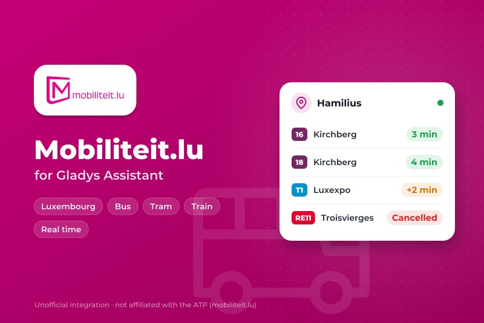
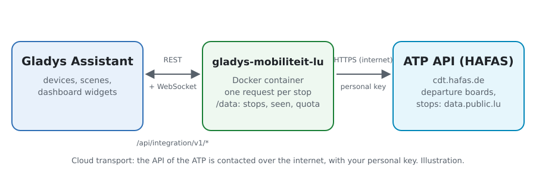
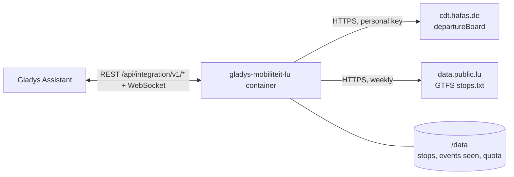
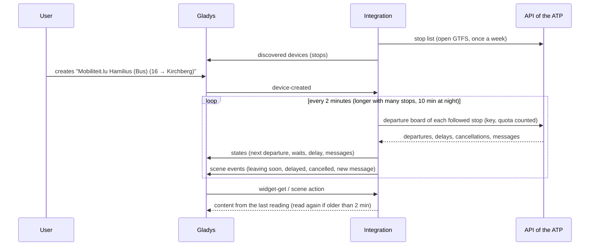
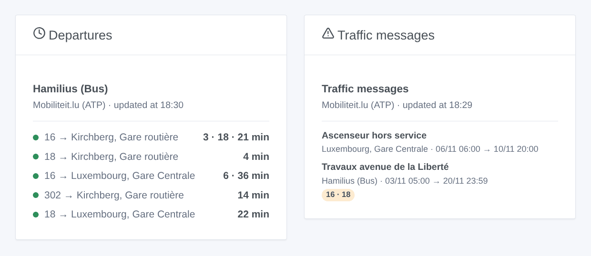

# Gladys Mobiliteit.lu

**English** · [Français](README.fr.md) · [Deutsch](README.de.md) · [Español](README.es.md)

[](LICENSE)
[](https://github.com/William-De71/gladys-mobiliteit-lu/releases)
[](https://github.com/William-De71/gladys-mobiliteit-lu/actions/workflows/release.yml)
[](https://gladysassistant.com)



[Gladys Assistant](https://gladysassistant.com) external integration for **Mobiliteit.lu**, the buses, trams and trains of Luxembourg: the next departures in real time at your stops, with their delay, the cancelled trips and the traffic messages, with scenes and dashboard widgets. It reads the official real-time API of the Administration des transports publics (ATP), with your personal key.

User documentation: [English](docs/en.md) · [Français](docs/fr.md) · [Deutsch](docs/de.md) · [Español](docs/es.md).

> Community integration, not affiliated with nor endorsed by the Administration des transports publics, mobiliteit.lu or the operators of the networks of Luxembourg.

> **Not yet tested with a real key.** The code follows the published schema of the API (`rest-2.52.xsd`) and its documentation, and the tests use boards built from that schema. Feedback from a user with a key is welcome.

## Features

- **One device per followed stop** (three in the form, up to 7 more with the **Add a stop** button), typed by name or by number and filtered by **line** ("16", "T1", "RE 11", or "tram", "train", "bus") and **direction**: next departure, wait of the next two departures, delay of the next one, number of traffic messages.
- **Every network**: RGTR, AVL, TICE and CFL buses, the Luxtram, CFL trains.
- **Real time**: the estimated time and the delay when the vehicle is followed, the timetable otherwise (marked as such), the cancelled trips.
- **4 scene triggers**, **1 scene action** and **2 dashboard widgets** (below).
- **The quota of the key kept**: requests counted, interval made longer with many stops, readings paused before the limits (about 500 an hour, 5,000 a day) and until the next full hour after an `API_QUOTA` answer.
- **Stop search without spending the key**: the names and numbers come from the open GTFS of the ATP, read weekly and kept in `/data`.
- Configuration buttons: test the connection, find a stop, add / remove / list stops, diagnostic (without the key).
- Four languages everywhere: English, French, German, Spanish.

## How it works





At start, the integration reads the stop list of the open GTFS of the ATP (the newest zip of the dataset on data.public.lu, only its `stops.txt`): a GTFS id "000200405060" is the HAFAS id "200405060". It resolves what you typed ("Hamilius" is "Hamilius (Bus)", 200405020), then reads the departure board of each followed stop (`departureBoard?id=…&format=json&duration=90`) on its own timer, one request per stop, and keeps the departures of the chosen line and direction. Each reading is compared with the previous one to fire the scene triggers.



### Transport

Cloud only (`"transports": ["cloud"]`): the catalog shows the cloud badge. The integration contacts `cdt.hafas.de` (with your key and the numbers of your stops) and `data.public.lu`. There is no local alternative, so there is no "prefer the local connection" button.

## Devices and features

| Device                 | Feature                      | Category / type              | Values                                                |
| ---------------------- | ---------------------------- | ---------------------------- | ----------------------------------------------------- |
| Mobiliteit.lu \<stop\> | Next passage                 | `text` / `text`              | "16 → Kirchberg, Gare routière · 3 min (+2 min late)" |
| Mobiliteit.lu \<stop\> | Wait, wait for the following | `duration` / `integer`       | 0 … 180 min                                           |
| Mobiliteit.lu \<stop\> | Delay of the next passage    | `duration` / `integer`       | 0 … 120 min                                           |
| Mobiliteit.lu \<stop\> | Traffic messages             | `counter-sensor` / `integer` | 0 … 20                                                |

At night, without any departure, the waits keep their last value (a 0 would announce a bus now); the delay is published only for a departure followed in real time.

## Scene triggers, actions and widgets



**Scene triggers** (once per transition; the first reading is a reference and fires nothing):

- **Departure soon**: a departure at a followed stop leaves in 2, 3, 5, 10, 15 or 20 minutes, on its real-time estimate. Filters: stop, minutes.
- **Departure delayed**: the delay of a departure of the next hour reaches 3, 5, 10 or 15 minutes. Filters: stop, minutes.
- **Departure cancelled**: a trip of the next hour at a followed stop is cancelled. Filter: stop.
- **New traffic message**: a new message about the departures of a followed stop. Filter: stop.

**Scene action**: **next departures** of a stop (line, destination, wait, time, real time or not, delay, the following one, a sentence).

**Widgets**: **Departures** (a followed stop, several in one list, or any stop typed in the settings) and **Traffic messages** (the followed stops, or the ones chosen).

Examples:

- When **the 16 towards Kirchberg leaves Hamilius in 5 minutes** → light the hall lamp in green.
- When **your train is 10 minutes late** or **cancelled** → send `{{triggerEvent.data.summary}}` to your phone.
- Every weekday at 7:30 → **read the next departures** of your stop and have the `summary` spoken by the kitchen speaker.

## Requirements

- Gladys Assistant **5.3.0** or later (widgets and scene triggers of external integrations, catalog keywords and countries of Gladys 5.3). Older instances cannot install the integration.
- A personal key of the API, free: ask for it by e-mail to `opendata-api@atp.etat.lu`.

## Installation

- **From the store** of Gladys (Integrations → External integrations), in one click, once indexed.
- **From the repository URL**: `https://github.com/William-De71/gladys-mobiliteit-lu`.
- **Developer mode**: build the image locally (`docker build -t gladys-mobiliteit-lu .`) and install it from Gladys.

## Configuration

| Field                 | Description                                                                    |
| --------------------- | ------------------------------------------------------------------------------ |
| Access key            | The key of the ATP (secret, never logged).                                     |
| Stop (1 to 3)         | A name ("Hamilius", "Luxembourg, Gare Centrale") or a number ("200405060").    |
| Line                  | "16", "T1", "RE 11", or "tram", "train", "bus". Empty: every line of the stop. |
| Direction             | Words of the destination: "Kirchberg", "Findel \| Kirchberg". Empty: both.     |
| Reading of the stops  | 1 min, 2 min (default), 5 min or 10 min; longer on its own with many stops.    |
| Language of the texts | Device names, scene summaries and outputs, language of the traffic messages.   |

Buttons: **Test the connection**, **Find a stop** (from the open stop list, without spending the key), **Add a stop**, **Remove a stop**, **List the stops** (the stops beyond the three of the form, kept in the Gladys configuration) and **Diagnostic** (writes the stops, last departures, errors, quota and requests to the Logs tab, never the key).

## Usage

1. Ask the ATP for a key, paste it, enter one to three stops — more with **Add a stop** — (with their line and direction if you wish), then save.
2. In the **Discover** tab, create the "Mobiliteit.lu …" devices.
3. Add the **Departures** and **Traffic messages** widgets to a dashboard, and build scenes with the triggers above.

## Development

```bash
npm install
npm test                       # node --test, never touches the network
npm run lint && npm run format:check
npx github:GladysAssistant/integration-store . --skip-image-check
scripts/build-cover.sh         # cover.jpg from docs/assets/cover.svg
docs/illustrations/render.sh   # docs/assets/widgets.<lang>.png
node .github/scripts/release.mjs next
```

Locally, the SDK reads `GLADYS_HOST_API_URL`, `GLADYS_INTEGRATION_TOKEN` and `GLADYS_INTEGRATION_SELECTOR`; `MOBILITEIT_API_URL` and `MOBILITEIT_GTFS_DATASET_URL` point the integration to other roots (a mock); `DEBUG=gladys-integration-sdk` shows the SDK logs and checks every widget content. The tests use boards built from the schema of the API and an extract of the real `stops.txt` (`test/fixtures/`, CC BY 4.0). The rules of the project are in [CLAUDE.md](CLAUDE.md).

## Release process


Every merge on `main` runs the CI, then computes the version from the [Conventional Commits](https://www.conventionalcommits.org/) since the last tag: `feat` → minor, `fix` / `perf` → patch, `!` or `BREAKING CHANGE` → major (a minor below 1.0.0); `docs`, `chore`, `ci`, `test`, `style`, `refactor`, `build` alone publish nothing. The changelog section is generated, the tag pushed, the multi-architecture image built, then `main` receives the release commit, the GitHub Release is created and a last job checks the public image, the store validator and the topic.

- The pull request title becomes the squash commit, then the changelog line: write it in English, for the user (`pr-title.yml` checks it). Never edit `CHANGELOG.md` by hand.
- 1.0.0 is a decision: Actions → Release → Run workflow with `release-as: 1.0.0`. `dry-run` shows the version and the notes without publishing.
- **Protected branch**: the release pushes its commit to `main` with `GITHUB_TOKEN`. With a ruleset on `main` stricter than "no deletion, no force-push", add GitHub Actions to its bypass list (or push through a GitHub App), otherwise the publish job fails with instructions.
- After the first release, make the `ghcr.io` package public (Package settings → Change visibility), or Gladys cannot pull it.

## Troubleshooting

See [docs/en.md](docs/en.md#troubleshooting). Report issues with the versions of Gladys and of the integration, the stop concerned, and the lines of the **Diagnostic** button.

## Contributing

Issues and pull requests are welcome. Run `npm run format:check && npm run lint && npm test` before opening a pull request, and keep every external id and stored key unchanged (see [CLAUDE.md](CLAUDE.md)).

## Security

See [SECURITY.md](SECURITY.md): report vulnerabilities privately. The access key is a secret of the configuration: it is only sent to the API of the ATP and never written in the logs, the diagnostic or the error messages. The container runs read-only, as a non-root user.

## Screenshots to come

The images above are illustrations, not screenshots. Real screenshots will go in `docs/assets/screenshots/` (PNG, 1280 × 800): `configuration.png`, `discovery.png`, `device.png`, `scene.png`.

## License

[Apache License 2.0](LICENSE) — see also [NOTICE](NOTICE). The departures and the stops are data of the Administration des transports publics (mobiliteit.lu) under [CC BY 4.0](https://creativecommons.org/licenses/by/4.0/): the widgets show the source and the time of each reading. Thanks to the Gladys documentation and SDK, and to the ATP for opening its real-time API.
