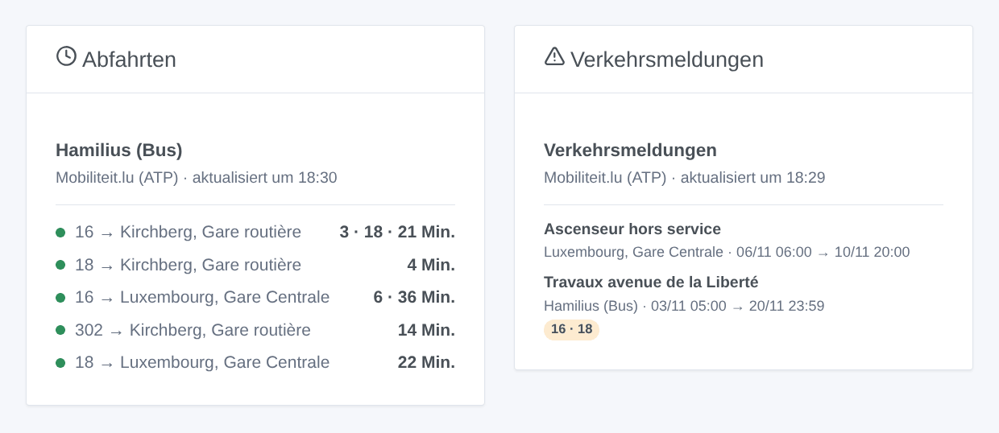

# Mobiliteit.lu

## Überblick

Diese Integration bringt die **Busse, Trams und Züge Luxemburgs** über **Mobiliteit.lu** in Gladys. Sie liefert die **nächsten Abfahrten in Echtzeit, mit ihrer Verspätung**, an den Haltestellen deiner Wahl (drei im Formular, bis zu 7 weitere per Schaltfläche), gefiltert nach Linie und Richtung: Busse von RGTR, AVL, TICE und CFL, die Luxtram, Züge der CFL. Sie zeigt auch die **Verkehrsmeldungen**, die die API den Abfahrten beifügt (Bauarbeiten, Umleitungen). Jede Haltestelle wird zu einem Gerät für ein Dashboard und für Szenen.

Die Abfahrten stammen aus der **offiziellen Echtzeit-API der Administration des transports publics (ATP)**, der API hinter mobiliteit.lu, unter der Lizenz CC BY 4.0. Sie braucht einen **persönlichen Schlüssel**, kostenlos, per E-Mail anzufragen. Namen und Nummern der Haltestellen stammen aus der offenen Haltestellenliste der ATP (ihr GTFS auf data.public.lu), einmal pro Woche gelesen: Die Suche nach einer Haltestelle verbraucht nie den Schlüssel.

Ein Schlüssel erlaubt **etwa 500 Anfragen pro Stunde und 5.000 pro Tag**. Jede verfolgte Haltestelle ist eine Anfrage pro Abfrage, standardmäßig alle 2 Minuten. Die Integration zählt ihre Anfragen: Bei vielen Haltestellen streckt sie die Abfragen von selbst (der Verbindungsstatus nennt das verwendete Intervall); nachts, solange keine Haltestelle in den nächsten 45 Minuten etwas ankündigt, liest sie alle 10 Minuten. Wird das Kontingent trotzdem erreicht, wartet sie bis zur nächsten vollen Stunde.

Eine Abfahrt wird **in Echtzeit verfolgt**, wenn die API eine geschätzte Zeit liefert: Dann ist ihre Verspätung bekannt. Sonst ist es der **Fahrplan**, markiert mit „(Fahrplan)“. **Entfallene Fahrten** werden gemeldet.

Dies ist eine **Cloud**-Integration: Sie kontaktiert `cdt.hafas.de` (den API-Server der ATP) und `data.public.lu`. Dein Schlüssel und die Nummern deiner Haltestellen werden an die API gesendet; nichts anderes verlässt dein Netzwerk.

Die Integration wurde nach dem veröffentlichten Schema der API (rest-2.52.xsd) und ihrer Dokumentation geschrieben; sie wurde noch nicht mit einem echten Schlüssel getestet. Dein Feedback ist willkommen.

## Voraussetzungen

- Gladys Assistant 5.3.0 oder neuer.
- Ein persönlicher Schlüssel der API: Frag ihn per E-Mail bei `opendata-api@atp.etat.lu` an, mit ein paar Worten zu deiner Nutzung (zum Beispiel „Hausautomation Gladys Assistant“). Der Schlüssel sieht aus wie `xxxxxxxx-xxxx-xxxx-xxxx-xxxxxxxxxxxx`.

## Konfiguration

| Feld                     | Was eingeben                                                                                                  |
| ------------------------ | ------------------------------------------------------------------------------------------------------------- |
| Zugangsschlüssel         | Der von der ATP erhaltene Schlüssel. Als Geheimnis gespeichert, nie in die Protokolle geschrieben.            |
| Haltestelle 1, 2, 3      | Der Name der Haltestelle („Hamilius“, „Luxembourg, Gare Centrale“) oder ihre Nummer („200405060“).            |
| Linie                    | Nur diese Linie: „16“, „T1“, „RE 11“, oder nur ein Verkehrsmittel: „tram“, „train“, „bus“. Leer: alle.        |
| Richtung                 | Nur die Ziele mit diesen Wörtern: „Kirchberg“, „Findel \| Kirchberg“. Leer: beide Richtungen.                 |
| Abfrage der Haltestellen | Jede Minute, alle 2 Minuten (Standard), 5 Minuten oder 10 Minuten; bei vielen Haltestellen von selbst länger. |
| Sprache der Texte        | Gerätenamen, Zusammenfassungen und Ausgaben der Szenen sowie Sprache der Verkehrsmeldungen (FR, DE oder EN).  |

Die Schaltfläche **Haltestelle suchen** liefert die Haltestellen mit einigen Wörtern, mit ihrer Nummer („Luxembourg, Gare Centrale [200405060]“). Eine Haltestelle gibt es oft zweimal, eine für die Busse und eine für die Tram („Hamilius (Bus)“, „Hamilius-Centre (Tram)“): Kopiere den Namen oder die Nummer der gewünschten. **Verbindung testen** liest die Haltestellenliste, jede Haltestelle sofort (eine Anfrage pro Haltestelle) und nennt das verbrauchte Kontingent.

Mehr Haltestellen als die drei des Formulars (Zuhause, Arbeit, Schule…): **Haltestelle hinzufügen** nimmt dieselben drei Felder — Haltestelle, Linie, Richtung — und verfolgt bis zu 7 weitere Haltestellen. **Haltestellen auflisten** zeigt alle verfolgten Haltestellen nummeriert; **Haltestelle entfernen** nimmt diese Nummer (oder den Namen). Die hinzugefügten Haltestellen bleiben in der Konfiguration von Gladys und damit in ihren Sicherungen.

## Verwendung

### Geräte

Erstelle im Tab **Entdecken** die gewünschten Geräte mit dem Namen **Mobiliteit.lu \<Haltestelle\>**: die nächste Abfahrt als Text („16 → Kirchberg, Gare routière · 3 Min. (+2 Min. Verspätung)“), die Wartezeit der nächsten und der folgenden Abfahrt (Minuten), die Verspätung der nächsten (Minuten, nur veröffentlicht, wenn sie in Echtzeit verfolgt wird; ein verfrühter Bus zählt 0) und die Anzahl der Verkehrsmeldungen.

Nachts, ohne jede Abfahrt, behalten die Wartezeiten ihren letzten Wert.

### Kontingent des Schlüssels

Jede Abfrage einer Haltestelle ist eine Anfrage: 3 Haltestellen alle 2 Minuten ergeben etwa 2.200 Anfragen pro Tag. Bei mehr Haltestellen wächst das Intervall, damit ein Tag an Abfragen unter 3.600 Anfragen bleibt; so bleibt Platz für die Widgets und die Szenenaktionen (ein Widget oder eine Aktion nutzt eine Abfrage von weniger als 2 Minuten erneut). Die Schaltfläche **Diagnose** nennt die Anfragen der letzten Stunde und der letzten 24 Stunden.

### Dashboard-Widgets

- **Abfahrten**: die nächsten Abfahrten einer Haltestelle, kompakt. Eine Zeile pro Linie und Ziel, mit ihren nächsten Abfahrten hintereinander („3 · 18 Min.“). Eine Verspätung ab 5 Minuten oder eine entfallene Fahrt färbt die Zeile orange. Die Einstellung **Angezeigte Fahrten** legt die Anzahl der Zeilen fest. Wähle eine verfolgte Haltestelle oder gib in den Widget-Einstellungen eine beliebige Haltestelle (und eine Linie) ein: Eine solche Haltestelle kostet bei jeder Aktualisierung eine Anfrage mehr, höchstens alle 2 Minuten. Mit **Mehrere Haltestellen** zeigt ein Widget mehrere Haltestellen-Geräte.
- **Verkehrsmeldungen**: die Meldungen zu den Abfahrten deiner Haltestellen, mit den betroffenen Linien und ihrem Zeitraum. Tippe auf eine Karte für den vollständigen Text.

### Szenen

Auslöser, einmal pro Änderung (die erste Abfrage dient nur als Referenz):

- **Mobiliteit.lu: Abfahrt bald**: Eine Abfahrt an einer verfolgten Haltestelle fährt in 2, 3, 5, 10, 15 oder 20 Minuten, gezählt nach der Echtzeit-Schätzung.
- **Mobiliteit.lu: Abfahrt verspätet**: Die Verspätung einer Abfahrt der nächsten Stunde erreicht 3, 5, 10 oder 15 Minuten.
- **Mobiliteit.lu: Abfahrt entfällt**: Eine Fahrt der nächsten Stunde an einer verfolgten Haltestelle entfällt.
- **Mobiliteit.lu: neue Verkehrsmeldung**: eine neue Meldung zu den Abfahrten einer verfolgten Haltestelle.

Jeder liefert einen fertigen Satz, `{{triggerEvent.data.summary}}`, und seine Werte (Linie, Ziel, geplante und geschätzte Zeit, Verspätung, Titel, Text, Beginn und Ende…). Die Aktion **Mobiliteit.lu: nächste Abfahrten** gibt dieselbe Art von Werten zurück, für eine Nachricht oder eine Bedingung.

Beispiele:

- Wenn die 16 Richtung Kirchberg in 5 Minuten an Hamilius abfährt → die Flurlampe grün schalten.
- Wenn dein Zug 10 Minuten Verspätung hat oder entfällt → die Zusammenfassung vor dem Losgehen an dein Handy senden.
- Jeden Werktag um 7:30 → die nächsten Abfahrten deiner Haltestelle lesen und vom Küchenlautsprecher ansagen lassen.

### Transport

Nur Cloud: Die Daten kommen aus dem Internet. Nur die verfolgten Haltestellen werden bei der API abgefragt, eine nach der anderen.

## Fehlerbehebung

- **„Gib den Zugangsschlüssel ein“**: Der Schlüssel fehlt; frag ihn bei `opendata-api@atp.etat.lu` an und füge ihn in die Konfiguration ein.
- **„Die API lehnt den Zugangsschlüssel ab“**: Prüfe ihn (kein Leerzeichen davor oder danach); die Integration fragt erst nach dem Speichern der Konfiguration erneut.
- **„Das Kontingent des Zugangsschlüssels ist aufgebraucht“**: Die API hat geantwortet, dass das Kontingent erreicht ist; die Abfragen gehen zur nächsten vollen Stunde weiter. Verfolge weniger Haltestellen oder wähle ein längeres Intervall.
- **„Unbekannt oder mehrdeutig“**: Nutze **Haltestelle suchen** und kopiere dann den genauen Namen oder die Nummer.
- **„(Fahrplan)“ nach einer Abfahrt**: Die API verfolgt dieses Fahrzeug nicht in Echtzeit; die Zeit ist die des Fahrplans.
- **Keine Abfahrt**: Nachts schläft das Netz; die Haltestellen werden alle 10 Minuten gelesen.
- **Um ein Problem zu melden**: Drücke **Diagnose** und kopiere die Zeilen, die mit „Mobiliteit.lu diagnostic“ beginnen, aus dem Tab Protokolle (der Schlüssel steht nicht darin) in ein GitHub-Issue oder eine Antwort im Forum, mit den Versionen von Gladys und der Integration.
