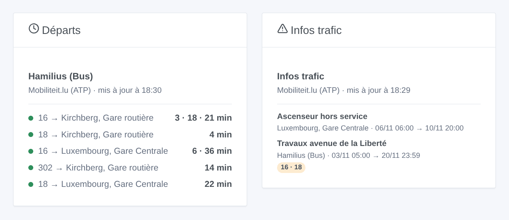

# Mobiliteit.lu

## Présentation

Cette intégration amène les **bus, trams et trains du Luxembourg** dans Gladys, via **Mobiliteit.lu**. Elle donne les **prochains départs en temps réel, avec leur retard**, aux arrêts de votre choix (trois dans le formulaire, jusqu’à 7 de plus avec un bouton), filtrés par ligne et par direction : bus RGTR, AVL, TICE et CFL, Luxtram, trains CFL. Elle affiche aussi les **infos trafic** que l’API joint aux départs (travaux, déviations). Chaque arrêt devient un appareil à afficher sur un tableau de bord et à utiliser dans des scènes.

Les départs viennent de l’**API temps réel officielle de l’Administration des transports publics (ATP)**, celle de mobiliteit.lu, sous licence CC BY 4.0. Elle demande une **clé personnelle**, gratuite, à demander par e-mail. Les noms et numéros des arrêts viennent de la liste ouverte des arrêts de l’ATP (son GTFS sur data.public.lu), relue une fois par semaine : chercher un arrêt ne consomme jamais la clé.

Une clé permet **environ 500 requêtes par heure et 5 000 par jour**. Chaque arrêt suivi est une requête par lecture, toutes les 2 minutes par défaut. L’intégration compte ses requêtes : avec beaucoup d’arrêts, elle espace d’elle-même les lectures (le statut de connexion donne l’intervalle utilisé) ; la nuit, tant qu’aucun arrêt n’annonce rien dans les 45 minutes, elle lit toutes les 10 minutes. Si le quota est quand même atteint, elle attend l’heure pleine suivante.

Un départ est **suivi en temps réel** quand l’API donne une heure estimée : son retard est alors connu. Sinon c’est l’**horaire théorique**, marqué « (théorique) ». Les **trajets supprimés** sont signalés.

C’est une intégration **cloud** : elle contacte `cdt.hafas.de` (le serveur de l’API de l’ATP) et `data.public.lu`. Votre clé et les numéros de vos arrêts sont envoyés à l’API ; rien d’autre ne quitte votre réseau.

L’intégration a été écrite d’après le schéma publié de l’API (rest-2.52.xsd) et sa documentation ; elle n’a pas encore été testée avec une vraie clé. Vos retours sont les bienvenus.

## Prérequis

- Gladys Assistant 5.3.0 ou plus récent.
- Une clé personnelle de l’API : demandez-la par e-mail à `opendata-api@atp.etat.lu`, avec quelques mots sur votre usage (par exemple « domotique Gladys Assistant »). La clé ressemble à `xxxxxxxx-xxxx-xxxx-xxxx-xxxxxxxxxxxx`.

## Configuration

| Champ              | Quoi saisir                                                                                                         |
| ------------------ | ------------------------------------------------------------------------------------------------------------------- |
| Clé d’accès        | La clé reçue de l’ATP. Enregistrée comme secret, jamais écrite dans les journaux.                                   |
| Arrêt 1, 2, 3      | Le nom de l’arrêt (« Hamilius », « Luxembourg, Gare Centrale ») ou son numéro (« 200405060 »).                      |
| Ligne              | Seulement cette ligne : « 16 », « T1 », « RE 11 », ou un mode seul : « tram », « train », « bus ». Vide : toutes.   |
| Direction          | Seulement les destinations qui contiennent ces mots : « Kirchberg », « Findel \| Kirchberg ». Vide : les deux sens. |
| Lecture des arrêts | Toutes les minutes, 2 minutes (par défaut), 5 minutes ou 10 minutes ; plus long de lui-même avec beaucoup d’arrêts. |
| Langue des textes  | Noms des appareils, résumés et sorties des scènes, et langue des infos trafic (FR, DE ou EN).                       |

Le bouton **Chercher un arrêt** donne les arrêts qui contiennent quelques mots, avec leur numéro (« Luxembourg, Gare Centrale [200405060] »). Un arrêt existe souvent deux fois, un pour les bus et un pour le tram (« Hamilius (Bus) », « Hamilius-Centre (Tram) ») : copiez le nom ou le numéro de celui que vous voulez. **Tester la connexion** lit la liste des arrêts, chaque arrêt tout de suite (une requête par arrêt) et donne le quota utilisé.

Plus d’arrêts que les trois du formulaire (maison, travail, école…) : **Ajouter un arrêt** prend les trois mêmes champs — arrêt, ligne, direction — et suit jusqu’à 7 arrêts de plus. **Lister les arrêts** montre tous les arrêts suivis, numérotés ; **Retirer un arrêt** prend ce numéro (ou le nom). Les arrêts ajoutés sont gardés dans la configuration de Gladys et suivent donc ses sauvegardes.

## Utilisation

### Appareils

Dans l’onglet **Découvrir**, créez les appareils voulus, nommés **Mobiliteit.lu \<arrêt\>** : le prochain départ en texte (« 16 → Kirchberg, Gare routière · 3 min (+2 min de retard) »), l’attente du prochain départ et du suivant (minutes), le retard du prochain (minutes, publié seulement quand il est suivi en temps réel ; un bus en avance compte 0) et le nombre d’infos trafic.

La nuit, sans aucun départ, les attentes gardent leur dernière valeur.

### Quota de la clé

Chaque lecture d’un arrêt est une requête : 3 arrêts lus toutes les 2 minutes font environ 2 200 requêtes par jour. Avec plus d’arrêts, l’intervalle grandit pour qu’une journée de lectures reste sous 3 600 requêtes, ce qui laisse de la place aux widgets et aux actions de scène (un widget ou une action réutilise une lecture de moins de 2 minutes). Le bouton **Diagnostic** donne les requêtes de la dernière heure et des dernières 24 heures.

### Widgets du tableau de bord

- **Départs** : les prochains départs d’un arrêt, en compact. Une rangée par ligne et destination, avec ses prochains départs à la suite (« 3 · 18 min »). Un retard de 5 minutes ou plus, ou un trajet supprimé, passe la rangée en orange. Le réglage **Trajets affichés** fixe le nombre de rangées. Choisissez un arrêt suivi, ou saisissez n’importe quel arrêt (et une ligne) dans les réglages du widget : un tel arrêt coûte une requête de plus à chaque rafraîchissement, toutes les 2 minutes au plus. Avec **Plusieurs arrêts**, un widget montre plusieurs appareils arrêts.
- **Infos trafic** : les messages sur les départs de vos arrêts, avec les lignes concernées et leur période. Touchez une carte pour le texte complet.

### Scènes

Déclencheurs, une fois par changement (la première lecture sert seulement de référence) :

- **Mobiliteit.lu : départ bientôt** : un départ à un arrêt suivi part dans 2, 3, 5, 10, 15 ou 20 minutes, compté sur son heure estimée en temps réel.
- **Mobiliteit.lu : départ en retard** : le retard d’un départ de l’heure à venir atteint 3, 5, 10 ou 15 minutes.
- **Mobiliteit.lu : départ supprimé** : un trajet de l’heure à venir à un arrêt suivi est supprimé.
- **Mobiliteit.lu : nouvelle info trafic** : un nouveau message sur les départs d’un arrêt suivi.

Chacun donne une phrase toute prête, `{{triggerEvent.data.summary}}`, et ses valeurs (ligne, destination, heure prévue et estimée, retard, titre, texte, début et fin…). L’action **Mobiliteit.lu : prochains départs** renvoie le même genre de valeurs, à mettre dans un message ou à tester dans une condition.

Exemples :

- Quand le 16 vers Kirchberg part de Hamilius dans 5 minutes → allumer la lampe de l’entrée en vert.
- Quand votre train a 10 minutes de retard ou est supprimé → envoyer le résumé sur votre téléphone avant de partir.
- Chaque jour de semaine à 7 h 30 → lire les prochains départs de votre arrêt et les faire annoncer par l’enceinte de la cuisine.

### Transport

Cloud uniquement : les données viennent d’internet. Seuls les arrêts que vous suivez sont demandés à l’API, un par un.

## Dépannage

- **« Saisissez la clé d’accès »** : la clé manque ; demandez-la à `opendata-api@atp.etat.lu` et collez-la dans la configuration.
- **« L’API refuse la clé d’accès »** : vérifiez-la (pas d’espace avant ou après) ; l’intégration ne redemande rien tant que la configuration n’est pas enregistrée.
- **« Le quota de la clé d’accès est épuisé »** : l’API a répondu que le quota est atteint ; les lectures reprennent à l’heure pleine suivante. Suivez moins d’arrêts ou choisissez un intervalle plus long.
- **« Inconnu ou ambigu »** : utilisez **Chercher un arrêt**, puis copiez le nom exact ou le numéro.
- **« (théorique) » après un départ** : l’API ne suit pas ce véhicule en temps réel ; l’heure est celle de l’horaire.
- **Aucun départ** : la nuit le réseau dort ; les arrêts sont lus toutes les 10 minutes.
- **Pour signaler un problème** : appuyez sur **Diagnostic**, puis copiez les lignes commençant par « Mobiliteit.lu diagnostic » de l’onglet Journaux (la clé n’y figure pas) dans une issue GitHub ou une réponse sur le forum, avec les versions de Gladys et de l’intégration.
